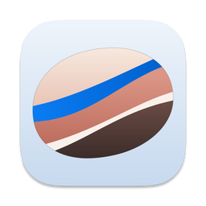
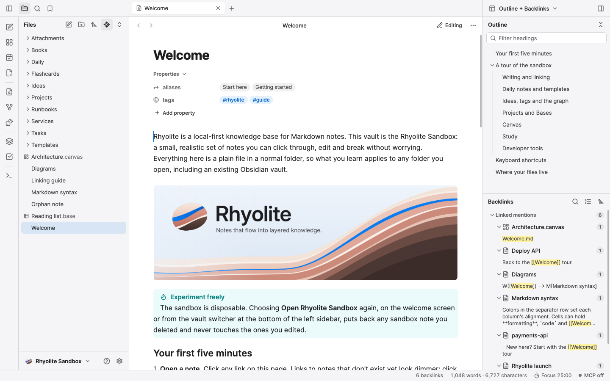

  

<h1 align="center">Rhyolite</h1>

  <b>Notes that flow into layered knowledge.</b> 
  A fast, local-first Markdown knowledge base for Mac, Windows, Linux, iPhone and iPad.

  <a href="https://rhyolite.app"><b>Website</b></a> ·
  <a href="https://github.com/Rhyolite-App/releases/releases/latest"><b>Downloads</b></a> ·
  <a href="https://github.com/Rhyolite-App/releases/issues"><b>Issue Tracker</b></a> ·
  <a href="https://rhyolite.app/support"><b>Support</b></a> ·
  <a href="https://rhyolite.app/privacy"><b>Privacy</b></a>

  <picture>
    <source media="(prefers-color-scheme: dark)" srcset="https://raw.githubusercontent.com/Rhyolite-App/.github/main/assets/editor-dark.png">
    
  </picture>

---

### Plain files in a folder you own

Every note in Rhyolite is an ordinary `.md`, `.canvas`, or `.base` file on your own drive. Open an existing Obsidian vault and carry on where you left off: wikilinks, embeds, callouts, typed properties, hotkeys, bookmarks, and graph settings work out of the box.

- **Write cleanly** — Live Preview hides Markdown syntax except where your caret is, with native LaTeX math typesetting, native Mermaid diagrams (8 diagram types, zero browser engine), syntax highlighting for 30+ languages, and optional Vim bindings.
- **Think in layers** — Global and local force-directed graphs, infinite JSON Canvas 1.0 boards, Obsidian-compatible Bases (tables, cards, lists, kanban), and FSRS-5 flashcards inside your notes.
- **Sync without lock-in** — Per-device caches stay outside your vault so iCloud Drive, OneDrive, Google Drive, Dropbox, Syncthing, and Git sync cleanly, with automatic three-way line merging and conflict review.
- **Built for AI agents & engineers** — Local [Model Context Protocol (MCP)](https://modelcontextprotocol.io) server over stdio and loopback HTTP with folder scopes, automatic secret redaction, destructive-change confirmation, and one-click revert, alongside docs-as-code drift checks and guarded runbooks.

### Repositories

| Repository | Purpose |
|---|---|
| **[Rhyolite-App/releases](https://github.com/Rhyolite-App/releases)** | Official desktop installers (macOS signed & notarized `.dmg`, Windows per-user setup `.exe`, Linux `~/.local` installer), portable archives, `SHA256SUMS.txt`, release notes, and public issue tracker. |
| **[Rhyolite-App/.github](https://github.com/Rhyolite-App/.github)** | Organization profile, [Security Policy](https://github.com/Rhyolite-App/.github/blob/main/SECURITY.md), [Support Guide](https://github.com/Rhyolite-App/.github/blob/main/SUPPORT.md), and issue templates. |

---

  © 2026 App Force, LLC · Questions or security reports: <a href="mailto:support@rhyolite.app">support@rhyolite.app</a>

